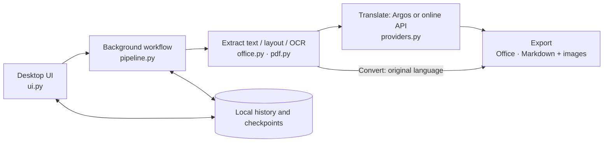

# DocBridge

A desktop application for Chinese-to-English document translation and
original-language Markdown conversion. For translation, choose **Office only**,
**Markdown only**, or **both**. Both exports use the same saved translation;
changing the output mode does not translate the document again.

| Input | Office output | Markdown output |
| --- | --- | --- |
| DOCX | DOCX with text patched in the original OOXML package | Markdown and images |
| PPTX | PPTX with frames, styles, and objects preserved | Markdown organized by slide, with images |
| XLSX | XLSX with formulas, charts, and images preserved | Markdown organized by sheet, with tables and images |
| Text-based or scanned PDF | Reconstructed DOCX | Markdown, tables, and images |

## Architecture

The desktop UI starts a separate worker process for parsing, OCR, translation
and export. All formats share a document model with blocks, segment IDs, source
anchors and translation revisions. The local store keeps job history and batch
checkpoints so translation can resume and reviewed results can be exported again.



Settings are saved separately from jobs; provider configuration contains no API
key. Keys use the operating system keyring or remain in memory for the session.
Online translation sends extracted text to the configured endpoint; Argos runs
locally. PDF extraction currently uses the PDF/OCR adapter shown above.

Translation exports automatically when complete. **Convert to Markdown** bypasses
translation providers, reads source text even when a translation already exists,
and retains translation checkpoints for later use. **Review** opens a separate
window from the entry menu; it is optional and never opens automatically. Saving
creates a new revision and marks older exports stale. **Re-export** uses stored
content without calling a translation provider. See [validation results](docs/DOCBRIDGE_VALIDATION.md)
for the tested behavior and current limitations.

## Run the development version

Requires Python 3.12 x64:

```powershell
python -m venv .venv
.venv\Scripts\python -m pip install --require-hashes -r requirements.lock
.venv\Scripts\python -m pip install -e ".[dev]"
.venv\Scripts\python -m converter
```

On Linux or macOS, use `.venv/bin/python` instead. Application data is stored in
`%LOCALAPPDATA%\DocBridge` on Windows or `$XDG_DATA_HOME/docbridge` on Linux
(default `~/.local/share/docbridge`). Existing Converter data is reused when the
new directory does not exist, preserving settings and history. Set
`DOCBRIDGE_DATA_DIR` to override this location. Legacy `CONVERTER_*` environment
variables and the `converter` command remain supported; DocBridge overrides take
precedence. The installed primary command is `docbridge`; the internal Python
package remains `converter` for compatibility.
The desktop interface defaults to **Light** mode and **English**. Use the **⚙ Settings**
icon to switch between Light/Dark or English/Tiếng Việt. These choices are saved
and applied immediately without restarting.

### Online translation

Open **⚙ Settings → Online service** and enter a service name, **API URL**,
**model ID**, and API key. Any service that implements the OpenAI-compatible
**Chat Completions** request/response format can be configured. The URL can be a
service root, a versioned base URL such as `https://host/v1`, or a full
`/chat/completions` endpoint. Base URLs are expanded before saving; query
parameters are retained for endpoints that require them.

**Advanced options** expose the authentication header/prefix, characters per
batch, maximum output tokens, context window, token safety margin, timeout,
and retry count. For example, use
`Authorization` with `Bearer `, or `api-key` with an empty prefix. Turn off
**Use API authentication** for services that do not require a key. HTTPS is
required except for services on localhost. **Test connection** uses the current
URL and model and sends a short sentence, which may incur a provider charge.

The configuration is saved in the application's data directory as `provider.json`,
without the API key. Keys use the operating system keyring; when unavailable,
a key can be used temporarily in the current session. **Save service** validates
the configuration; closing Settings also retains incomplete configuration drafts.
Settings do not need to contain a working provider to build or use offline mode.

`config/provider.json` supplies initial defaults. If no saved user configuration
exists, `DOCBRIDGE_PROVIDER_CONFIG` or the ignored `config/provider.local.json` can
supply development defaults. Saved user settings take precedence on subsequent
starts; passing an explicit path to `ProviderConfig.load` still selects that file.
Never put API keys in these JSON files or in a build.

### Context and output limits

Set **Context window** to the actual limit of the selected model. The initial
value of 8192 is a configuration default, not detected model metadata. Each
request reserves **Maximum output tokens** and **Safety margin** (default 512)
before allocating input space. A valid configuration leaves at least 1024
estimated input tokens for the prompt and source text.

For arbitrary providers without an exact tokenizer, the application conservatively
estimates input using the UTF-8 byte size of the full serialized messages, including
the system instruction, source text, optional context, placeholders, JSON, and chat
framing. This is an estimate rather than an exact vendor token count; it can create
more requests than a model-specific tokenizer. Runtime overflow handling remains
necessary if the configured model limit or tokenizer assumptions differ.

The online provider splits batches before sending when they exceed this budget.
If one segment is too large, optional context is removed first, then the complete
source is split without cutting glossary phrases, product codes, numbers or URLs.
API context-limit errors (recognized HTTP 400 errors or HTTP 413) and truncated
output (`finish_reason=length`) trigger further splitting. Unrelated errors retain
their normal retry/error behavior. Partial JSON is discarded, and every segment ID
and protected value must validate before a translated batch is saved. If even the
smallest source cannot fit, the app stops with an actionable error. Pause/cancel
is checked between split requests; previously saved batches remain available.

### Offline translation with Argos

Use the existing `translate-zh_en-1_9.argosmodel` package. The download link to the
[Argos Translate Package Index](https://www.argosopentech.com/argospm/index/) is also
available in **⚙ Settings → Offline & OCR**. Choose a Chinese → English
`.argosmodel` package there, or leave the field empty to use the bundled package.
The selected path is saved; selected packages are installed in an isolated local
cache so they take precedence over older models. Changes to the selected package
change the translation profile, preventing incompatible job resumes. The link does
not download a model automatically. Offline mode also requires the Argos runtime.
For development:

```powershell
.venv\Scripts\python -m pip install torch==2.5.1 --index-url https://download.pytorch.org/whl/cpu
.venv\Scripts\python -m pip install -e ".[offline]"
$env:DOCBRIDGE_ARGOS_MODEL = "D:\Models\translate-zh_en-1_9.argosmodel"
.venv\Scripts\python -m converter
```

Alternatively, place the package in `assets/models/`. It is installed locally
once. The application does not query the package index or download a replacement
model. Release builds bundle the installed model, so end users do not need to
configure Argos. The chosen model is accepted as a project requirement; no model
selection or benchmarking step is required.

Offline translation keeps complete sentence context after substituting glossary
terms. It accepts a result only when terms, codes and numeric values are retained.
If a glossary phrase is misspelled, it can retry with an unambiguous acronym
already present in that term, then restore its full name. A protected-fragment
fallback remains available. These checks preserve terminology and values;
they do not establish general semantic accuracy of the local model.

### Scanned PDFs and OCR

Development installations need Tesseract on PATH with the `chi_sim`, `chi_tra`,
and `eng` language packs. Set `DOCBRIDGE_TESSERACT` to select an executable.
Windows releases bundle Tesseract and its language packs in `assets/tesseract/`.
Pages with a text layer are read directly; scanned pages use OCR. Images inside
text-based PDFs are processed separately when needed. Review allows source
PDF/OCR text to be corrected before translation resumes.

If Tesseract is already installed, run `python scripts/setup-ocr.py` to prepare
local language packs. The script downloads from a pinned upstream revision and
verifies SHA-256 checksums.

## Usage

1. Drag and drop documents or add files, then select the rows to process.
   **Add documents ▼ → Add folder** scans subfolders for DOCX, PPTX, XLSX and PDF, skips Office lock
   files (`~$...`) and the application's internal job/output directories, and selects
   all imported rows.
2. Choose **Translate to English** or **Convert to Markdown** and a destination.
   For translation, choose online/offline and an output mode.
   The folder icon inside the destination field opens the folder picker.
3. Click **Translate / Resume**. The primary action becomes **Pause** while running;
   **Cancel** is in the `⋯` menu. Pause and cancel take
   effect after the current request or batch. Completed batches are saved so work
   can resume after restarting the application.
4. Results stay in the list when processing finishes. To make a correction,
   right-click an entry, double-click it, or use **⋯ → Review translation**.
   Review opens a separate window and saves edits when closed. Previously exported
   files are marked as stale when their translation changes.
5. Choose **⋯ → Re-export reviewed translation**. This requires
   neither an API key nor new translation requests.

History, source copies, checkpoints, and assets are stored in the application
data directory. Removing a job from history deletes its internal data, while
leaving original documents and exported files intact. Existing output names are
preserved by adding a suffix to new files. If one exporter fails in Both mode,
the successful output is retained and the other error is reported separately.

### Convert without translation

Choose **Convert to Markdown**, add/select documents, choose a destination and
click **Convert to Markdown**. Translation-service and Office-output controls
are hidden for this task. It requires neither an API key nor an Argos model.
PDF scans still require local OCR. Output uses the original language and names
such as `manual.md` plus `manual.assets/`; translation uses `manual.en.md`.
Existing files receive a suffix rather than being overwritten.

## Built-in terminology

**Settings → Glossary** starts with **97 editable automotive/Bosch/AUTOSAR term pairs**.
The Chinese phrases are curated for this app; English names are checked against
public official sources. This is not an official Bosch or AUTOSAR bilingual
glossary. See [source details](docs/GLOSSARY_SOURCES.md) or **Glossary sources**
in the app for provenance.

Search, edit, add or remove terms, and use **Apply glossary during translation**
to enable or disable replacements without losing your entries. **Add missing
automotive terms** restores absent entries and preserves custom translations.
Existing user terminology overrides a starter-pack entry with the same source;
deleted entries remain deleted after restarting. Changing the glossary during an
unfinished translation requires a new job to keep its profile consistent.

## Format limitations

- Word and PowerPoint retain text runs, styles, images, tables, and relationships.
  Main document/presentation/workbook parts and linked headers, footers and
  shared strings are discovered through OPC relationships, including custom
  part filenames. Markdown labels Word ancillary sections by their role.
  Explicit inline line breaks and Word tabs retain their order in paragraph
  context and Markdown; Markdown uses `<br>` for these line breaks, including
  inside table cells. Word tab-stop settings remain in the original Office XML.
  Longer translations may change pagination or overflow text frames. Groups with
  different styles are translated separately, using paragraph context online;
  sentences with complex mixed formatting need review.
- XLSX retains formula structure and numeric cells. Exact text criteria in
  SUMIF/COUNTIF/AVERAGEIF and their IFS variants follow translated labels in
  directly referenced cell/column ranges. Conflicting reviewed labels or new
  matches are rejected before writing an output. Wildcards, named/external
  ranges, computed criteria and other formula functions are not synchronized;
  recalculate and inspect these workbooks in a spreadsheet application.
  Markdown retains the original formula text. Shared strings are cloned per cell
  when different translations are needed. Sheet names are not translated.
  Chart titles and text labels are translated; ordinary worksheet references
  and embedded XLSX chart workbooks share targets with their chart caches.
  External/unsupported references can reset cached labels when refreshed.
  SmartArt data/cached drawing text and drawing text boxes are extracted;
  matching paragraph groups share a reviewed target. Complex SmartArt layouts
  still need native Office validation. Charts and SmartArt retain their native
  geometry but are represented by text/data rather than images in Markdown.

- PDF-to-DOCX reconstructs source page sizes and page boundaries, paragraphs,
  font sizes/emphasis, ruled tables, image dimensions and simple two-column bands.
  Column bands use borderless Word tables with a gutter; full-width headings and
  notes remain outside them. Inter-block whitespace
  is approximate and slightly reduced for longer English text; pagination can
  still change. Complete rectangular grids in scans are detected and OCR is run
  per cell; low-confidence/unread grids retain their source image. Substantial
  unrecognized figure regions are also kept at their source scale. Unruled or
  merged-cell scan tables and complex multi-column layouts need
  further verification. It does not reproduce every PDF graphic or font exactly.
  Weak text lines receive a cropped single-line OCR retry; fragmented scan
  regions can additionally retry with slightly emphasized strokes. Accepted
  replacements retain the original layout anchors and existing numbers/codes.
  Confidence scores do not guarantee transcription accuracy; source scans may
  still need checking before sending extracted text to an online translator.
- Legacy DOC/PPT/XLS, macros, encrypted files, and digitally signed Office files
  are not supported in this version.
- Markdown preserves representable document structure, not all Office formatting.

Office parser references and the choice to patch the original OOXML package
are documented in [Office parsing research](docs/OFFICE_PARSING_RESEARCH.md).

## Build for Linux

Use Python 3.12, install the CPU PyTorch and `[offline,build]` dependencies,
prepare the local `.argosmodel`, and run `scripts/setup-ocr.py` as described above.
Tesseract must be installed on the target Linux machine. To bundle the installed
model and runtime:

```bash
mkdir -p build/argos-packages
ARGOS_PACKAGES_DIR="$PWD/build/argos-packages" ARGOS_DEVICE_TYPE=cpu \
  .venv/bin/python -c 'from pathlib import Path; from argostranslate import package; package.install_from_path(Path("assets/models/translate-zh_en-1_9.argosmodel"))'
DOCBRIDGE_BUNDLE_OFFLINE=1 \
DOCBRIDGE_BUNDLE_MODELS="$PWD/build/argos-packages" \
DOCBRIDGE_BUNDLE_TESSERACT="$PWD/assets/tesseract" \
  .venv/bin/python -m PyInstaller --noconfirm --clean packaging/converter.spec
.venv/bin/python scripts/collect-notices.py dist/DocBridge/THIRD_PARTY_NOTICES.txt
.venv/bin/python scripts/check-size.py dist/DocBridge
```

Start with `dist/DocBridge/DocBridge`. Keep `_internal` beside the executable.
For a startup and real offline inference check with Python network connections
blocked, use an isolated data directory:

```bash
QT_QPA_PLATFORM=offscreen DOCBRIDGE_DATA_DIR="$PWD/.test-data/release-smoke" \
  dist/DocBridge/DocBridge --smoke-test "$PWD/build/release-smoke.json" --offline-smoke
```

See [actual local model results](docs/OFFLINE_SMOKE.md) for the real Chinese → English
smoke test, including translation errors that still require review. Portability
to other Linux distributions has not been validated.

## Build for Windows

Prepare Windows x64, Python 3.12, the existing Argos package, and a complete
Tesseract distribution including its executable, DLLs, license files, and language
packs. Users configure their provider in Settings after installation. API keys are
not included in builds.

```powershell
.\scripts\build-windows.ps1 `
  -ModelPath "D:\Models\translate-zh_en-1_9.argosmodel" `
  -TesseractPath "D:\Tesseract-OCR"
```

The script installs the CPU runtime and local Argos package, builds
`dist\DocBridge` using PyInstaller, and enforces an installed footprint below
2 GB. If Inno Setup 6 is on PATH or supplied through `-IsccPath`, it also creates
`dist\DocBridge-Setup-0.1.0.exe` and checks the installer size. Qt uses
Essentials/Widgets without WebEngine. Release distributions include
`THIRD_PARTY_NOTICES.txt`. Builds are unsigned; code signing and automatic updates
are not implemented.

After building, run `DocBridge.exe` on a clean Windows machine and exercise
online/offline translation, Chinese scanned PDFs, and all three output modes.
The cloud development environment runs Linux; Windows builds and installers
must be validated on Windows before release.

## Application checks

```powershell
.venv\Scripts\python -m pytest -q
.venv\Scripts\python -m ruff check src tests scripts
```

Tests cover OOXML round trips, retained styles and media, cell-specific shared
strings, formulas/charts/images, all output modes, review/re-export, resume,
HTTP errors, placeholder validation, PDF tables, scanned-page OCR, and offscreen
UI startup. Fixture providers and mock HTTP validate application behavior, not
Argos model quality or connectivity to the production translation service.
The scanned OCR test runs when Tesseract and a suitable test font are available.

See [docs/DESIGN.md](docs/DESIGN.md) for the detailed design (in Vietnamese).
