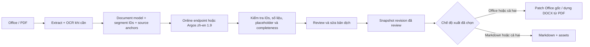

# Converter — thiết kế ứng dụng Windows

Trạng thái: đã có implementation v0.1 trong `src/converter`, tests và hướng dẫn
đóng gói. UI/pipeline được kiểm tra trong cloud Linux; bản phát hành Windows
với model/OCR bundle và dịch vụ online thật cần chạy tại môi trường đích.

## 1. Yêu cầu đã chốt

- Ứng dụng desktop Windows, ưu tiên Windows 10/11 x64; có build Linux x86_64.
- Hướng dịch chính: Trung → Anh. Có fixture riêng cho giản thể và phồn thể.
- Nguồn dịch online: dịch vụ OpenAI-compatible Chat Completions. Người dùng chỉnh
  API URL, model ID, header/prefix xác thực, timeout, retry và batch/token trong Settings.
- UI mặc định sáng và English; có chuyển tối/Tiếng Việt, lưu lựa chọn giữa các phiên.
- Nút Add folder quét thư mục con và nhập DOCX/PPTX/XLSX/PDF; bỏ file khóa Office.
- Glossary có 97 thuật ngữ automotive/Bosch/AUTOSAR có nguồn, cho sửa và bật/tắt.
- Model offline đã chọn: file `translate-zh_en-1_9.argosmodel` người dùng đang có,
  chạy Trung → Anh trên CPU. Người dùng đã xác nhận dùng Argos là phù hợp; không
  cần đánh giá lại model trước triển khai.
- Toàn bộ ứng dụng cùng runtime, model dịch, OCR và font đi kèm phải dưới 2 GB.
  Để tránh nhập nhằng, mục tiêu áp dụng cho cả installer và thư mục sau cài đặt,
  đo bằng byte với ngưỡng 2.000.000.000. Tài liệu và cache người dùng không tính
  vào gói phần mềm, nhưng có chức năng dọn cache.
- Bản đầu hỗ trợ DOCX, PPTX, XLSX và PDF, gồm PDF có text và PDF scan.
- Người dùng chọn một trong ba chế độ: **chỉ Office**, **chỉ Markdown**, **cả hai**.
  Chỉ chạy exporter đã chọn; không mặc định tạo cả hai file.
- Với Office đầu vào: đầu ra Office cùng định dạng, giữ cấu trúc và formatting
  của tài liệu gốc; Markdown giữ cấu trúc nội dung trong khả năng biểu đạt của nó.
- PDF là định dạng đầu vào; PDF đã dịch không thuộc output yêu cầu.
  Người dùng đã xác nhận PDF → DOCX và/hoặc Markdown trong bản đầu. DOCX từ PDF
  được dựng lại gần đúng; không có OOXML gốc để giữ nguyên format. Đây là giới
  hạn đã thống nhất, khác với yêu cầu giữ formatting ở Office → Office.

Repository ban đầu chỉ có README. Implementation mới dùng dataclasses cho
document model, pdfplumber để đọc bảng PDF, và giữ nguyên kiến trúc PySide6 +
worker process + SQLite. Hướng dẫn chạy/build và giới hạn cụ thể nằm trong README.
API dùng endpoint `/chat/completions`; base URL được chuẩn hóa trước khi lưu.
Người dùng chọn URL/model và cơ chế xác thực. Tích hợp dịch vụ thật cần kiểm tra
response theo schema Chat Completions.

## 2. Lựa chọn kiến trúc

Chọn Python 3.12 + PySide6 Widgets, worker process, SQLite và adapter tài liệu.

| Thành phần | Lựa chọn | Lý do |
| --- | --- | --- |
| Giao diện | PySide6 Widgets | Desktop thực, hỗ trợ kéo thả, bảng, review và DPI cao |
| Preview nội dung | QTextBrowser / bảng / ảnh trang PDF | Tránh phụ thuộc QtWebEngine trong gói đầu |
| Pipeline | Python, Pydantic, worker process | Tách UI khỏi OCR, parsing và inference |
| Office | ZIP + lxml; adapter OOXML riêng | Giữ phần không thay đổi của file gốc |
| Online | HTTP client qua provider adapter | URL/model và xác thực chỉnh trực tiếp trong Settings |
| Offline | Argos provider dùng `translate-zh_en-1_9.argosmodel` | Lựa chọn đã chốt theo xác nhận của người dùng |
| PDF đọc/render | pdfminer.six + pypdfium2 | Text có vị trí và render để preview/OCR |
| PDF → DOCX | python-docx cho file dựng mới | Tách khỏi adapter patch Office gốc; độ trung thực bố cục cần kiểm chứng |
| OCR | Tesseract + chi_sim, chi_tra, eng | Có thể bundle bản CPU và language packs nhỏ |
| Dữ liệu | SQLite + file assets | Checkpoint, lịch sử, review và resume |
| API key | Windows Credential Manager | Không lưu key trong config/project export |
| Phân phối | PyInstaller onedir + Inno Setup | Installer không yêu cầu cài Python; tránh bung model mỗi lần mở |

Tesseract binary và native wheels phải được pin phiên bản,
kiểm tra checksum, license và kiểm chứng đóng gói trên Windows trước release.
Đây là lựa chọn kỹ thuật đề xuất, không phải danh sách dependency đã chạy thử.

Không cần Ollama, server local hoặc bước chuyển model OPUS-MT. Không đưa CUDA,
Transformers, Docling hay LibreOffice vào gói chuẩn. Đóng gói dependencies cần
thiết của runtime Argos đã chọn cùng ứng dụng. Docling vẫn là ứng viên cho xử lý
PDF nâng cao nếu cần và đáp ứng ngân sách dung lượng.

## 3. Pipeline chung và ba chế độ xuất



Dịch một lần, lưu theo segment ID. Exporter được chọn nhận cùng revision,
glossary và bản dịch. Chế độ được lưu bằng `output_mode = office | markdown | both`.

| Input | Chỉ Office | Chỉ Markdown | Cả hai |
| --- | --- | --- | --- |
| DOCX | DOCX đã dịch | MD + assets khi có | DOCX + MD và assets khi có |
| PPTX | PPTX đã dịch | MD + assets khi có | PPTX + MD và assets khi có |
| XLSX | XLSX đã dịch | MD + assets khi có | XLSX + MD và assets khi có |
| PDF text/scan | DOCX dựng lại | MD + assets khi có | DOCX dựng lại + MD và assets khi có |

Chỉ Markdown: bỏ qua Office writer và kiểm tra round-trip Office; vẫn parse đầy
đủ nội dung cần dịch. Không cần tạo DOCX/PPTX/XLSX tạm làm đầu vào Markdown.
Chỉ Office: bỏ qua Markdown exporter và các assets riêng phục vụ Markdown.
Cả hai: dịch đúng một lượt; trạng thái hoàn thành dựa trên hai exporter.

Sửa một đoạn làm cũ các output đã tạo từ revision trước. Đổi chế độ xuất hoặc
yêu cầu output thứ hai dùng lại bản dịch đã lưu, không tự gửi dịch lại. Chỉ những
segment thiếu/chưa hợp lệ mới cần dịch; thay provider/glossary hoặc người dùng
yêu cầu dịch lại là thay đổi riêng, không phải hệ quả của chọn output.

Không dịch file Markdown lần thứ hai vì sẽ tăng chi phí và có thể làm lệch
nội dung so với Office. Không dựa vào vị trí đoạn sau khi render để nối bản dịch.

Document model tối thiểu gồm:

- Document: checksum file nguồn, adapter/version, language, danh sách blocks.
- Block: heading, paragraph, list, table, image, page/slide/sheet break.
- Segment: ID ổn định trong một bản parse, source text, target text, trạng thái,
  source anchor, inline styles, protected tokens, cảnh báo và revision.
- Source anchor: OOXML part + node identity; sheet + cell; PDF page + bbox.
- Asset: file ảnh, hash, loại và liên kết đến block; chart chưa diễn giải được
  có thể xuất ảnh preview nếu có renderer, nếu không ghi rõ phần chưa xuất.
- Job: provider profile/version, model revision, glossary version, tiến độ,
  checkpoint, `output_mode`, trạng thái và revision của từng exporter.

Segment ID không hứa ổn định khi file nguồn hoặc adapter đổi. Dùng checksum
để chặn resume nhầm tài liệu. Cache translation phải gồm source, context cần
thiết, provider/model, ngôn ngữ, glossary và prompt version; không chỉ source text.

## 4. Giao diện và hành vi

Điều hướng gồm: Documents & history, Review và Glossary. Nút bánh răng mở hộp
Settings gồm General, Online service và Offline & OCR.

Màn hình Tài liệu:

```text
Converter                                          Cài đặt
---------------------------------------------------------
[ Add documents ▼ ] [ ⋯ ] hoặc kéo thả DOCX / PPTX / XLSX / PDF

Tên file            Loại      Tiến độ        Kết quả
contract.docx       Word      Chờ dịch
catalogue.pdf       PDF       Cần OCR

Nguồn: Trung        Đích: Anh
Chế độ: [ Dịch online v ]   [ Thuật ngữ: Mặc định v ]
Xuất:   ( ) Chỉ Office    ( ) Chỉ Markdown    (o) Cả hai
Lưu vào: D:\Translations                  [ Chọn thư mục ]

                                  [ Translate / Resume ]
```

Tên provider hiển thị thân thiện, không hiện chi tiết endpoint/model trong luồng
dịch thông thường. Online là mặc định; “Offline — Argos Trung → Anh” có sẵn
trong cùng dropdown. Lựa chọn chế độ dịch độc lập với lựa chọn chế độ xuất.
UI ghi rõ online gửi nội dung đến dịch vụ cấu hình sẵn, offline xử lý trên máy.

Nhớ `output_mode` đã chọn; mặc định đề xuất Cả hai cho lần đầu, đây là mặc định
UI chứ không phải ràng buộc workflow. Nếu adapter không hỗ trợ output yêu cầu,
báo rõ theo từng file trước khi dịch, không âm thầm đổi lựa chọn trong batch.
Với PDF, UI ghi rõ “Office (.docx dựng lại)” bên cạnh lựa chọn; batch có cả Office
và PDF hiển thị định dạng đích ở từng hàng để người dùng biết file sẽ nhận được.

Cài đặt dịch vụ lần đầu:

1. Nhập API URL (base hoặc endpoint đầy đủ), model ID và API key nếu cần xác thực.
2. Bấm Kiểm tra kết nối. Chỉ dùng request không chứa tài liệu; nếu cần gọi model
   để xác minh quyền thì dùng một câu thử ngắn và thông báo request có thể tính phí.
3. Lưu key vào Windows Credential Manager; cho phép thay/xóa key.

Chưa có key vẫn mở và dịch Offline được. Không tự chuyển online → offline
vì lỗi API; thông báo lỗi và cho người dùng chọn để tránh trộn chất lượng âm thầm.

Màn hình Review có hai cột: nội dung gốc và bản dịch. PDF có thêm ảnh trang và
vùng được chọn; Office có chỉ dẫn đoạn/slide/cell. Lọc cảnh báo, chưa dịch,
đã sửa; sửa nội dung rồi lưu; dịch lại riêng đoạn; xuất output đã chọn.
Preview Office mặc định là cấu trúc nội dung, không phải rendering giống Word.

Tạm dừng có hiệu lực sau batch/request đang xử lý; hủy giữ checkpoint nếu người
dùng muốn tiếp tục sau. Trạng thái riêng: chờ, phân tích, OCR, dịch, review,
xuất file, hoàn thành, hoàn thành có cảnh báo, tạm dừng, lỗi, đã hủy.
Một output thành công và output kia lỗi trong chế độ Cả hai phải hiển thị riêng,
không ghi hoàn thành toàn bộ. Output không được chọn có trạng thái “Không yêu cầu”,
không tính là lỗi hoặc thiếu. Retry exporter lỗi dùng lại bản dịch đã có.
Progress có segment hoàn thành/tổng và giai đoạn hiện tại; không bịa ETA.

Kết quả ví dụ khi chọn Cả hai:

```text
contract.en.docx
contract.en.md
contract.en.assets/
```

Chỉ Office chỉ tạo `contract.en.docx`; chỉ Markdown chỉ tạo `contract.en.md` và
thư mục assets khi cần. Report/cảnh báo nằm trong project nội bộ, chỉ xuất
`contract.en.report.json` khi người dùng yêu cầu báo cáo, không luôn tạo file phụ.

Markdown xuất UTF-8; path ảnh tương đối để chuyển thư mục vẫn đọc được.
Không ghi đè nguồn. Khi trùng tên, chọn tên có suffix hoặc hỏi ghi đè output.
Không xuất API key hay nội dung prompt có key trong report.

## 5. Dịch online

Endpoint/model ID nằm trong provider profile người dùng chỉnh trong Settings;
profile được lưu vào thư mục dữ liệu app và không chứa API key. Bản đóng gói chỉ
cung cấp giá trị ban đầu. Có thể tắt xác thực cho dịch vụ không cần key.
Adapter dùng Chat Completions với `model` và `messages`. Xác minh response theo OpenAI-compatible schema khi tích
hợp endpoint thật; path giống nhau chưa đủ chứng minh mọi feature đều tương thích.
Không phụ thuộc structured-output mode hoặc streaming nếu endpoint chưa hỗ trợ;
bản đầu dùng request không streaming và kiểm tra nội dung response. Không giả
định key là Bearer cho mọi API trước khi biết cơ chế xác thực của dịch vụ.

Chia batch theo token/context limit của model đã chốt, không cắt ngang tùy tiện
theo số ký tự. Request chứa segment IDs, văn cảnh cần thiết, glossary và vùng
không được dịch. Response được kiểm tra đủ IDs, không trùng, không thêm đoạn,
không mất số/mã/placeholder. Output LLM là dữ liệu, không thực thi lệnh.

Retry có giới hạn cho timeout/429/5xx, tôn trọng Retry-After. Lỗi 401/403 hoặc
hết quota không lặp vô hạn. Lưu kết quả từng batch vào transaction trước batch
kế tiếp. Request bị timeout sau khi provider đã xử lý có thể bị tính phí lần nữa;
chỉ dùng idempotency key khi endpoint hỗ trợ, không hứa resume không tốn thêm phí.

Đổi model/profile trong job đang dở phải tạo revision mới và ghi provenance;
không trộn kết quả không có dấu vết. Ước tính chi phí chỉ xuất hiện khi profile
có giá/token và tokenizer đáng tin; nếu chưa biết thì hiển thị chưa xác định.

## 6. Argos đã chốt và đóng gói offline

Dùng đúng `translate-zh_en-1_9.argosmodel` người dùng đang sử dụng. Người dùng
đã xác nhận Argos đáp ứng nhu cầu và yêu cầu bỏ bước kiểm tra/đánh giá lại model.
Không đưa benchmark chất lượng Argos, so sánh model hoặc khảo sát model thay thế
thành prerequisite hay tiêu chí chặn triển khai. Đây là quyết định theo xác nhận
của người dùng, không phải tuyên bố model đã được chạy thử trong workspace này.

Tích hợp qua `argostranslate`, cài package từ file local và giữ model/tokenizer
của package hiện có. Pin phiên bản thư viện và dependencies dùng cho bản phát hành;
phiên bản package 1.9 và phiên bản thư viện là hai thông tin riêng. Không cần
Ollama, chuyển model sang OPUS-MT hoặc xây adapter CTranslate2 thay thế.

Bundle model đã cài cùng runtime và resources tách câu cần thiết. Tránh giữ cả
archive và bản giải nén trong thư mục cài đặt. Người dùng cuối không phải cài
Python/Argos hay import model. Không gọi cập nhật index hoặc tải model tự động
trong luồng chạy offline; dùng toàn bộ resources đã đóng gói.

Glossary và ánh xạ text vào styled spans thuộc trách nhiệm pipeline tài liệu.
Không dùng prompt instruction cho Argos như với LLM. Adapter phải giữ liên kết
segment, xử lý protected tokens và báo đoạn cần review khi chưa thể bảo toàn
format. Kiểm tra các hành vi này là kiểm tra ứng dụng, không đánh giá lại model.

Giới hạn toàn ứng dụng dưới 2 GB vẫn là yêu cầu đóng gói. Tối ưu bằng cách loại
venv build, cache, model trùng lặp và dependencies không dùng; giữ đúng runtime
cần thiết. Dung lượng được quản lý ở bước tạo installer, không dùng làm điều kiện
mở lại quyết định chọn Argos. Không gán kích thước giả định cho file model hoặc
khẳng định gói cài đã đạt giới hạn khi chưa tạo artifact.

## 7. Office: giữ cấu trúc và giới hạn hỗ trợ

Đọc OOXML package, chỉ sửa phần text đã xác định và metadata bắt buộc liên quan.
Copy nguyên nội dung giải nén của những ZIP entries không thay đổi. Không rebuild
toàn bộ workbook bằng openpyxl khi yêu cầu giữ charts/images/objects.
Entries sửa qua XML có thể khác serialization; kiểm tra tree để bảo đảm style,
relationships, media, công thức và phần không liên quan giữ nguyên về ngữ nghĩa.

| Định dạng | Phần dịch trong bản đầu | Phần giữ nguyên / cần xử lý rõ |
| --- | --- | --- |
| DOCX | Body, tables, headers/footers, footnotes/endnotes, textbox text chuẩn | Styles, ảnh, hyperlink đích, fields, equations; tracked changes cần cảnh báo |
| PPTX | Textboxes, table cells, grouped shapes, speaker notes | Geometry, images, charts, SmartArt; text trong chart/SmartArt chưa dịch thì ghi vào report |
| XLSX | Text cells, shared/inline strings và rich text được hỗ trợ | Formulas, numeric cells, charts/images, references; không đổi sheet names |

Không nhận DOC/PPT/XLS legacy hoặc macro-enabled files trong bản đầu; giải thích
cần chuyển sang DOCX/PPTX/XLSX. File mã hóa hoặc chữ ký số được phát hiện và
báo chưa hỗ trợ thay vì tạo bản dịch với chữ ký không còn hợp lệ.

DOCX/PPTX dịch theo đoạn với dấu mốc inline khi online; validate dấu mốc trước
ghi lại runs. Chỉ đổi nội dung được cho phép; không dùng paragraph.text để thay
toàn bộ đoạn nếu thao tác đó xóa cấu trúc runs. Khi dấu mốc sai, retry có giới hạn
hoặc chuyển đoạn sang review. Dịch từng run đơn lẻ không phải mặc định vì mất ngữ cảnh.

XLSX sharedStrings cần giữ ánh xạ cell. Hai cell cùng source nhưng cần bản dịch
khác thì thêm shared string mới và cập nhật index đúng cell, không sửa chung mù quáng.
Cell có công thức, kể cả string cached result, không dịch như text thường.

Giữ style và objects không đồng nghĩa giữ nguyên số trang: Trung → Anh thay đổi
độ dài. Không tự giảm font toàn file. PPTX cảnh báo nguy cơ overflow; chỉ điều chỉnh
text frame có chủ đích khi người dùng chọn, và ghi vào report. Không hứa đo overflow
Office chính xác nếu chưa có renderer Word/PowerPoint/LibreOffice.

“Giữ nguyên format” là tiêu chí nghiệm thu Office → Office: styles, cấu trúc,
relationships, objects và layout properties phải được giữ; nội dung dịch không
được làm mất bold/italic trong đoạn. Nếu thuật toán không ánh xạ đúng text vào
styled spans, đoạn đó cần review hoặc chặn xuất hoàn chỉnh. File cần sửa lại
format không được báo là đã đáp ứng yêu cầu. Markdown là biểu diễn cấu trúc nội
dung, không hứa lưu toàn bộ formatting Office. Việc căn chữ theo nghĩa giữa
Trung và Anh là trách nhiệm của adapter tài liệu và phải được kiểm tra về format.

## 8. PDF ngay từ bản đầu

PDF có text: extract text + vị trí + font + ảnh; dựng thứ tự đọc theo cột và vùng.
PDF scan: render từng trang, OCR chi_sim/chi_tra/eng, lưu text + bbox + confidence.
PDF hỗn hợp quyết định OCR theo từng trang/vùng, tránh OCR rồi dịch trùng text có sẵn.

Đầu ra: DOCX và/hoặc Markdown từ document model đã dịch/review. Không cần PDF writer,
ReportLab hoặc chức năng phủ text lên PDF để đáp ứng yêu cầu output hiện tại.
PDF render vẫn cần cho preview/OCR, độc lập với việc xuất file đã dịch.

Khi PDF được chọn xuất Office, dựng DOCX mới với heading, paragraphs, tables,
images và thứ tự đọc đã extract. Nếu chọn Cả hai, DOCX và Markdown lấy cùng
revision. Không dựng DOCX trung gian khi chỉ cần MD.

PDF → DOCX là conversion/reconstruction, không phải patch Office gốc. Người dùng
đã chấp nhận giữ cấu trúc gần đúng ở nhánh này, không cam kết giống hệt bố cục PDF,
số trang hoặc fonts. Đây là phạm vi riêng đã xác nhận, không hạ tiêu chí giữ
format của Office đầu vào. PDF hỗ trợ đầy đủ ba output modes từ bản đầu.

Bảng phức tạp, chữ trong biểu đồ/ảnh, công thức, chữ viết tay và scan kém có thể
chưa nhận đúng. Cảnh báo vùng không hiểu; cho phép sửa OCR trước dịch. Không chỉ
chấm translation quality khi extraction đã sai. Markdown giữ bảng đơn giản;
bảng merge phức tạp dùng HTML trong Markdown hoặc ảnh kèm text và cảnh báo.

Assets giữ ảnh đã extract; project lưu liên kết page nguồn để đối chiếu. Forms,
annotations hoặc nội dung khác chưa extract được phải xuất hiện trong báo cáo
coverage; không tuyên bố dịch đủ tài liệu chỉ vì OCR xử lý thành công vài vùng.

## 9. Markdown exporter

Exporter chính dựng từ document model đã review. Heading/list/table/link lấy từ
cấu trúc đã extract; chỉ text nodes dùng bản dịch. Escape ký tự Markdown và giữ
URLs, code, equations, numbers theo chính sách của từng loại nội dung.

PPTX có heading theo slide; XLSX theo sheet + table; PDF có page markers khi cần
đối chiếu. DOCX không nhét page numbers giả khi chưa render phân trang.

MarkItDown dùng làm đối chứng hoặc thử nghiệm extractor, không bắt buộc trong
runtime đầu. Quyết định sau review: Markdown exporter đọc document model trực
tiếp, để MD-only không phụ thuộc việc ghi Office thành công và Both không dịch
hai lần. Kiểm tra coverage giữa source, model và output; ghi rõ cấu trúc/ảnh chưa
biểu diễn được. Không coi file Markdown tồn tại là đã xuất đủ nội dung.

## 10. Runtime, lưu trữ và khôi phục

UI gọi worker qua multiprocessing queues, không cần HTTP server hay browser.
Windows spawn entrypoint cần freeze_support, message schema/version và lifecycle
rõ. Worker chỉ gửi IDs, tiến độ và errors; không gửi QWidget qua process.

Mỗi job có thư mục dưới %LOCALAPPDATA%\Converter\jobs\<id>, source copy, assets
và SQLite records. Một coordinator quản lý trạng thái/ghi DB; worker không ghi
xung đột. Export từ revision snapshot sang temp file cùng volume rồi atomic rename.
Ứng dụng khởi động lại nhận diện job dở và cho resume, không giả định process còn sống.

Provider concurrency giới hạn cấu hình; OCR/PDF page xử lý từng lô để không giữ
toàn bộ ảnh độ phân giải cao trong RAM. Worker lỗi không làm mất bản review đã lưu.
Giữ log kỹ thuật không ghi API key hoặc toàn bộ tài liệu; nút mở thư mục kết quả,
xóa lịch sử và dọn cache nằm trong UI.

## 11. Tái sử dụng dự án đã nêu

- doc-translator: tham khảo provider client, batching, checkpoints, revision và
  format interfaces. Không fork toàn ứng dụng web làm nền desktop trước khi đối
  chiếu licensing/dependencies và test fixture Office. README chính dự án xác nhận
  mixed Word styles có thể bị gom, và charts/images Excel có thể bị mất.
- MarkItDown: đối chứng conversion và thử nghiệm nhanh Markdown; README nói rõ
  mục tiêu chính là text analysis, không bảo đảm conversion fidelity cho người đọc.
- Docling: có parsing/OCR/export Markdown và Windows support theo README;
  chưa đưa vào gói chuẩn do ngân sách bundle/model cần đo riêng.
- anydoc và preserve-format skill: chưa kiểm chứng API/artifact trong vòng thiết kế
  này; không coi là dependency đã chốt hoặc đã test.
- PyMuPDF: README nêu AGPL/commercial; lựa chọn PDF mặc định phía trên tránh
  ràng buộc chưa chốt này. Nếu chọn PyMuPDF phải xác định phương án phân phối trước.

Nguồn đã đọc trong vòng thiết kế: README của các dự án; bổ sung index Argos,
package loader và dependencies của Argos trong lần review này. Đây không phải
thử nghiệm chức năng hoặc audit source toàn diện. Model offline đã chọn theo
người dùng và được coi là đáp ứng nhu cầu; bỏ bước đánh giá lại Argos khỏi plan.

## 12. Tiêu chí nghiệm thu và thứ tự triển khai

Mọi định dạng dưới đây thuộc bản đầu; thứ tự phát triển không bỏ PDF khỏi scope:

1. Dựng khung PySide6 và tích hợp Argos với file có sẵn; thêm endpoint adapter
   và OCR. Thử adapter giữ styled spans Office và PDF hai cột/scan → DOCX/Markdown.
   Không có giai đoạn đánh giá lại model Argos.
2. Lõi: job store, document model, providers, checkpoints, glossary và export revision.
3. Adapters DOCX/PPTX/XLSX, PDF text/OCR; Markdown từ cùng document model;
   DOCX reconstruction cho PDF → Office.
4. UI import/batch/review/export, ba output modes, API key đơn giản và chọn Offline.
5. Release candidate Windows, fixture thực tế, installer và thông báo giới hạn.

Acceptance gates:

- Chạy trên Windows sạch không cài Python, Office, Ollama hoặc CUDA.
- Installer và installed footprint < 2.000.000.000 byte; offline translate + OCR
  chạy khi ngắt mạng, không first-run download ẩn.
- Kiểm tra luồng ứng dụng online/offline cho cả ba output modes trên Office;
  số request dịch không tăng khi chọn Both so với cùng job ở chế độ một output.
  Model Argos là thành phần đã được người dùng chấp nhận, không có gate đánh giá
  lại chất lượng model.
- DOCX mixed styles/table/header, PPTX grouped shape/table/notes, XLSX rich cells/
  formula/chart/image: source unchanged, untranslated ZIP parts hash giữ nguyên,
  changed XML passes semantic invariant checks; file mở được bằng Office.
- PDF text một/hai cột, scan giản thể/phồn thể, mixed pages và tables: kiểm tra
  extraction/OCR trước dịch, nội dung không bị bỏ; output MD đọc được và DOCX
  reconstruction được kiểm tra về headings, thứ tự đọc, bảng và ảnh. Test cả
  ba output modes cho PDF, gồm cả online và offline.
- Chỉ Office không tạo MD; chỉ Markdown không gọi Office writer; Both tạo hai
  output từ một revision. Exporter không chọn không ảnh hưởng job status.
- Review thay một segment: các outputs được chọn phản ánh đúng revision; đổi
  output mode hoặc retry exporter không gọi dịch lại những đoạn đã có kết quả.
  Nếu source/adapter đổi, resume bị chặn đúng.
- 401/429/network drop, invalid model response, app restart, hủy export và disk full:
  lỗi rõ, checkpoint dùng lại đúng, không tạo output thành công giả.
- Tính toàn vẹn dữ liệu: segment không bị bỏ, lặp hoặc ghép sai; số/đơn vị/
  protected tokens và nội dung đã review được giữ đúng khi xuất. Không yêu cầu
  benchmark Argos hoặc so chất lượng offline với online.
- UI không treo khi OCR/inference; test path tiếng Trung/Việt, spaces và DPI cao.

Thiết kế đã mô tả các gates ứng dụng; chưa thực thi chúng. Bước triển khai đầu
tiên là dựng khung ứng dụng, tích hợp Argos và làm pipeline tài liệu.

## 13. Thông tin còn cần cho implementation

- URL/model, xác thực và giới hạn của dịch vụ thật do người dùng nhập trong Settings;
  cần kiểm tra kết nối trước khi xử lý tài liệu thật.
- Fixture tài liệu zh-en để kiểm tra extraction, OCR, bảo toàn format và xuất file.
- File `translate-zh_en-1_9.argosmodel` được đưa vào assets ở bước implementation/
  đóng gói; không cần cung cấp để tiếp tục chốt thiết kế hoặc đánh giá model.

Không cần cung cấp API key trong chat. Người dùng nhập key vào ứng dụng sau này.

## Nguồn tham khảo

- https://github.com/ilysom0611/doc-translator
- https://github.com/microsoft/markitdown
- https://github.com/docling-project/docling
- https://github.com/OpenNMT/CTranslate2
- https://github.com/argosopentech/argos-translate
- https://github.com/argosopentech/argos-translate/blob/v1.9.6/requirements.txt
- https://github.com/argosopentech/argos-translate/blob/v1.9.6/argostranslate/package.py
- https://github.com/argosopentech/argospm-index/blob/main/index.json
- https://github.com/pymupdf/PyMuPDF

## 14. Model và glossary người dùng

Settings → Offline & OCR có link [Argos Translate Package Index](https://www.argosopentech.com/argospm/index/)
và chọn file `.argosmodel` Trung → Anh. Model được chọn dùng cache riêng theo
hash nội dung để không bị model cũ trong bundle ghi đè. Hash vào profile job;
đổi model cần job mới. Không tải model tự động.

Glossary dùng bộ thuật ngữ biên soạn cho app, đối chiếu tên tiếng Anh với nguồn
chính thức Bosch/AUTOSAR. Nguồn nằm trong `docs/GLOSSARY_SOURCES.md`.
Thuật ngữ người dùng ghi đè mục mặc định cùng nguồn; việc xóa được lưu qua restart.
Khôi phục chỉ thêm mục còn thiếu; tắt áp dụng không xóa bảng.

## 15. Giới hạn context của LLM

Settings có context window và token dự phòng theo model do người dùng cấu hình.
Ngân sách input = context window − max output tokens − safety margin. UI không
khẳng định đã tự phát hiện giới hạn/tokenizer của provider. Ước lượng bảo thủ dùng
byte UTF-8 của messages đã serialize, kể cả system prompt, JSON và context.

Online provider tự chia batch trước khi gửi; đoạn quá dài bỏ context phụ rồi chia
nguồn đầy đủ ở ranh giới an toàn, không cắt thuật ngữ/mã/số/URL. Lỗi context HTTP
400 được nhận diện, HTTP 413 và output bị cắt (`finish_reason=length`) dẫn tới chia
nhỏ tiếp. Lỗi HTTP khác dùng cơ chế retry hiện có. Không lưu JSON dở; toàn bộ IDs
và placeholders phải được kiểm tra trước checkpoint. Không chia được nữa thì báo
lỗi cấu hình có thể xử lý. Pause/cancel được kiểm tra giữa các request nhỏ.

## 16. Giao diện gọn và kiểm tra offline thực tế

Settings dùng icon bánh răng 18 px trong vùng bấm 28 px, tự đổi màu theo palette.
Màn hình chính có Add documents với menu Add folder, menu ⋯ chứa Review/Open output/
Re-export/Remove history, và một hành động chính Translate / Resume. Khi chạy,
hành động chính đổi thành Pause; Cancel chỉ xuất hiện trong menu ⋯ khi có worker.
Double-click mở Review. Chọn thư mục output bằng icon trong ô đường dẫn. Khi chưa
có tài liệu, màn hình hiển thị hướng dẫn kéo thả thay vì bảng trống.

Model Argos zh-en 1.9 đã tải và chạy thật trên CPU, với kết nối Python bị chặn.
DOCX/PPTX/XLSX/PDF text/PDF scan xuất được cả Office và Markdown. Runtime/model đã
được nhúng vào bản Linux và kiểm tra inference bằng executable. Kết quả cụ thể,
bao gồm lỗi ngữ nghĩa của model và OCR, nằm trong `docs/OFFLINE_SMOKE.md`.
